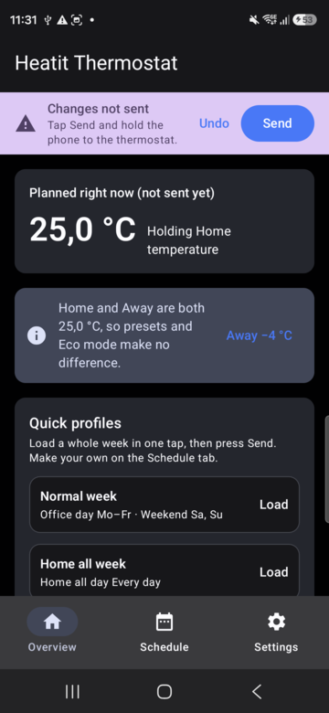
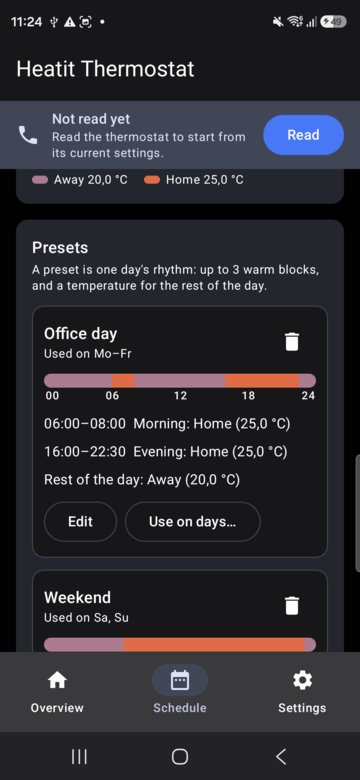
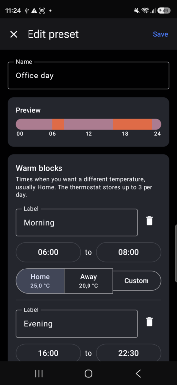
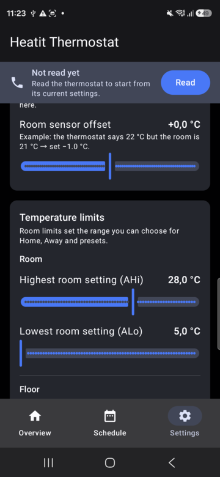

# Heatit NFC Thermostat – open app and protocol

An open-source Android app for **Heatit NFC floor-heating thermostats**, plus full documentation of the NFC protocol they use. It was reverse-engineered from the official app and checked against a real thermostat, so you can build your own tools too.

<p>
  
  
  
  
</p>

> **Not affiliated with Heatit or Thermo-Floor.** "Heatit" is their trademark. This is an independent project for interoperability with hardware you own. Use it at your own risk; wrong installer settings (sensor type, floor limits) can damage floors.

## What's in this repository

| Path | What it is |
| --- | --- |
| [`android/`](android) | The Android app (Kotlin, Jetpack Compose) |
| [`docs/PROTOCOL.md`](docs/PROTOCOL.md) | The NFC protocol: transport, every field, schedule format, checksum, examples |
| [`docs/REVERSE_ENGINEERING.md`](docs/REVERSE_ENGINEERING.md) | How the protocol was worked out, step by step, and how to make your own client |
| [`tools/heatit_nfc.py`](tools/heatit_nfc.py) | A standalone Python encoder/decoder with a self-test |

## How the thermostat works over NFC

The thermostat looks to your phone like an ordinary NFC tag holding **one NDEF Text record** of plain text:

```
nfc
pr:ou047
md:3            ← mode: 0 Off, 1 Comfort, 2 Eco, 3 Schedule
sp:2d,24        ← Home / Away setpoints in 0.5 °C steps (hex): 22.5 / 18.0 °C
op:0            ← regulation: room, room+floor, floor or external sensor
…
d0:24,1a42d,1e024,3c02d,56424,fffff,fffff   ← Monday: base temp + switch points
…
tm:0e,1e,00,5   ← clock sync from the phone
rc:61c7         ← CRC-16/CCITT-FALSE
```

The phone writes the whole record and the thermostat's firmware reads it over I²C. There is no pairing, password or encryption. Full details are in **[docs/PROTOCOL.md](docs/PROTOCOL.md)**.

## The app

The app is built around what people actually want from a heating schedule: warm in the morning, cooler while you're at work, warm again in the evening, and different at the weekend.

- **Overview:** shows what the thermostat is doing right now and when it changes next, lets you pick the mode (each one explained), and sets your **Home** and **Away** temperatures.
- **Quick profiles:** load a whole week in one tap, e.g. *Normal week* (office days Mon–Fri, weekend Sat–Sun), *Home all week*, or *Away / holiday*. You can save your own.
- **Schedule:** build **day presets** with up to 3 warm blocks (the most the thermostat stores) and assign them to days. Blocks can follow your Home/Away temperatures, so changing Home updates every preset at once.
- **Settings:** installer options, each with an explanation: regulation mode, sensor types, calibration, room and floor limits, brightness, display, child lock, adaptive start.
- **Safe writes:** warns before sending without reading first, reads back after every write to confirm it, checks the checksum, and shows the raw NFC text for troubleshooting.
- Works offline. Presets and profiles are stored on the phone, and nothing is sent anywhere.

### Using it

1. Turn on NFC and open the app.
2. Tap **Read** and hold the back of the phone against the thermostat until it confirms.
3. Change what you want, or load a profile.
4. Tap **Send** and hold the phone to the thermostat again.

### Building

You need JDK 17+ and the Android SDK (API 36).

```bash
cd android
./gradlew testDebugUnitTest assembleDebug
# APK: android/app/build/outputs/apk/debug/app-debug.apk
adb install -r app/build/outputs/apk/debug/app-debug.apk
```

`local.properties` is not committed. Android Studio creates it, or you can write `sdk.dir=/path/to/Android/Sdk` yourself.

Requires Android 8.0 (API 26) or newer, with NFC.

## Python tool

```bash
python tools/heatit_nfc.py selftest              # verify the codec
python tools/heatit_nfc.py decode capture.txt    # pretty-print a payload you captured
python tools/heatit_nfc.py example               # print an example write payload
```

To capture a payload, use this app (**Settings → Raw NFC data**), NXP TagInfo or NFC Tools. Pair the tool with [nfcpy](https://nfcpy.readthedocs.io/) and a USB reader to write from a PC (see [REVERSE_ENGINEERING.md §7](docs/REVERSE_ENGINEERING.md#7-make-your-own-client)).

## Compatibility

| Tested | Product code | Firmware |
| --- | --- | --- |
| Heatit NFC thermostat (exact model to be confirmed) | `ou047` | 1.1.0 |

Have another model or firmware? Please open an issue with a capture from **Settings → Raw NFC data**, **with the `sn:` line removed**.

## Contributing

Issues and pull requests are welcome, especially:

- captures from other models or firmware versions
- answers to the [open questions](docs/PROTOCOL.md#10-open-questions) (NFC chip type, what `ds:` does, how the firmware handles a bad checksum)
- translations (the official app has Finnish and Swedish)

Please run `./gradlew testDebugUnitTest` and `python tools/heatit_nfc.py selftest` before opening a pull request.

## Legal

This repository contains no code or assets from the official app. The protocol description is the result of independent analysis for interoperability. The official APK must not be committed here (it is listed in `.gitignore`).

Licensed under the [MIT License](LICENSE).
