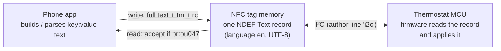

# Heatit NFC thermostat protocol

This is the over-the-air format used by Heatit NFC thermostats (product code `ou047`). It was reverse-engineered from the official Android app and checked against a real thermostat. It has everything you need to read and write the thermostat from your own app or script.

> **Short version:** the thermostat looks to a phone like an ordinary NFC tag holding **one NDEF Text record** of plain ASCII `key:value` lines, such as `md:3` or `sp:2d,24`. Temperatures are hex in 0.5 °C steps. Every write ends with a CRC-16/CCITT-FALSE checksum. There is no password, no encryption and no proprietary NFC command.

Contents

1. [Data path](#1-data-path)
2. [NFC transport](#2-nfc-transport)
3. [Message format](#3-message-format)
4. [Fields](#4-fields)
5. [Weekly schedule](#5-weekly-schedule)
6. [Checksum](#6-checksum)
7. [Examples](#7-examples)
8. [Security notes](#8-security-notes)
9. [Behaviour of the official app](#9-behaviour-of-the-official-app)
10. [Open questions](#10-open-questions)

---

## 1. Data path



The phone and the thermostat never talk to each other directly. They share the memory of a dual-interface NFC tag: the phone uses the NFC side and the thermostat's microcontroller uses the I²C side. When the firmware writes the record, it puts `i2c` on the first line, which confirms this setup. The exact chip is still unknown; it behaves like an ST25DV or NTAG I2C.

## 2. NFC transport

Use the standard NDEF APIs only. No raw commands (`transceive`) are needed.

**Read**

1. Connect to the tag as `Ndef` (Android: `Ndef.get(tag).connect()`).
2. Read the NDEF message and take the first record with TNF `0x01` (Well-Known) and type `T` (`RTD_TEXT`).
3. Decode the Text payload. Byte 0 is the status byte: bit 7 is the encoding (0 = UTF-8, 1 = UTF-16) and bits 0–5 are the length of the language code. The text starts after the language code.

**Write**

1. Build the full message text (see below).
2. Wrap it in one Text record with language `en`, UTF-8 (Android: `NdefRecord.createTextRecord("en", text)`).
3. Write it as the only record (`writeNdefMessage`). This replaces the whole tag, so partial updates aren't possible. **Always send every field**, ideally after reading the current values first.

The original app uses foreground dispatch on `TAG_DISCOVERED`. Reader mode (`NfcAdapter.enableReaderMode` with NFC-A/B/F/V flags) also works and is what the app in this repository uses.

## 3. Message format

- Lines are separated by `\n`. There is no newline after the final `rc:` line.
- **Line 1 is the author.** The official app writes `nfc`; the thermostat writes `i2c`. Parsers should ignore it.
- Every other line is `kk:value`, where `kk` is a 2-letter key.
- Numbers are **lowercase hex** unless the table says decimal.
- Unknown lines should be ignored. The thermostat adds `vn:` and `sn:`, which the official app never reads.

**Order written by the official app**

```
<author>
pr  md  sp  op  st  ca  br  lm  cl  ds  as  d0 … d6  tm  rc
```

**Order written by the thermostat** (observed)

```
i2c
pr  vn  sn  md  sp  op  st  ca  br  lm  cl  ds  as  d0 … d6  rc
```

The thermostat doesn't write `tm:`. The clock only flows from the phone to the thermostat.

## 4. Fields

| Key | Format | Meaning | Written by |
| --- | --- | --- | --- |
| *(line 1)* | text | Author: `nfc` (app) or `i2c` (thermostat) | both |
| `pr:` | text | Product code, always `ou047` | both |
| `vn:` | `hh,hh,hh` | Firmware version, e.g. `01,01,00` = 1.1.0 | thermostat |
| `sn:` | decimal | Serial number, e.g. `sn:1234567890` | thermostat |
| `md:` | decimal 0–3 | Operating mode | both |
| `sp:` | `hh,hh` | Comfort (Home) setpoint, Eco (Away) setpoint | both |
| `op:` | decimal 0–3 | Regulation mode | both |
| `st:` | `d,d` | Floor sensor type, external sensor type | both |
| `ca:` | `hh` signed | Room sensor calibration | both |
| `br:` | `h` | Display brightness | both |
| `lm:` | `hh,hh,hh,hh` | Limits: AHi, ALo, FHi, FLo | both |
| `cl:` | 0/1 | Child lock | both |
| `ds:` | 0/1 | Display status | both |
| `as:` | 0/1 | Adaptive start | both |
| `d0:`–`d6:` | 7 fields | Weekly schedule, Monday (`d0`) to Sunday (`d6`) | both |
| `tm:` | `hh,hh,hh,d` | Clock: hour, minute, second (hex), weekday (decimal, 0 = Monday) | app |
| `rc:` | `hhhh` | CRC-16, see [Checksum](#6-checksum) | both |

### Temperatures

Most temperatures are **half-degree steps in hex**: °C = value × 0.5, so `2d` = 45 = 22.5 °C.

| Field | Encoding | Range used by the official app | Example |
| --- | --- | --- | --- |
| `sp:` comfort, eco | half-degrees | ALo–AHi (modes A, AF), FLo–FHi (mode F), 5–40 °C (mode A2) | `2d,24` = 22.5 / 18.0 °C |
| `lm:` AHi, FHi | half-degrees | 14–80 (7.0–40.0 °C) | `37` = 27.5 °C |
| `lm:` ALo, FLo | half-degrees | 10–76 (5.0–38.0 °C), Lo ≤ Hi | `15` = 10.5 °C |
| `ca:` | **tenths** of a degree, two's-complement byte | −40…+40 (−4.0…+4.0 °C) | `f1` = −1.5 °C |
| Schedule temps | half-degrees | 10–80, kept within the active limits | `24` = 18.0 °C |

In mode F, `sp:` and the schedule temperatures are **floor** temperatures. In modes A, AF and A2 they are **room** temperatures.

### Enumerations

| Field | Values |
| --- | --- |
| `md:` operating mode | 0 = Off, 1 = Comfort, 2 = Eco, 3 = Schedule |
| `op:` regulation mode | 0 = A (built-in room sensor), 1 = AF (room sensor, floor kept within FLo–FHi), 2 = F (floor sensor), 3 = A2 (external room sensor) |
| `st:` sensor type, each digit | 0 = 10 kΩ, 1 = 12 kΩ, 2 = 15 kΩ, 3 = 22 kΩ, 4 = 33 kΩ, 5 = 47 kΩ, 6 = 6.8 kΩ |
| `br:` brightness | `0`–`9` = level, `a` = automatic |
| `cl:` child lock | 0 = off, 1 = on (locks the buttons only; NFC still works) |
| `ds:` display status | 0 = off, 1 = on. Meaning not confirmed; probably "display always on" |
| `as:` adaptive start | 0 = off, 1 = on (start heating early so the room is warm when a period begins) |

`st:` uses a remapped order. The official app lists 6.8 kΩ first in its menu but sends it as code `6`.

## 5. Weekly schedule

Each `dN:` line has exactly **7 comma-separated fields**:

```
d0:24,1a42d,1e024,3c02d,56424,fffff,fffff
   │  └──┬──┘
   │     └ switch point: TTT = minute of day (hex), tt = temperature (half-degrees, hex)
   └ base temperature from 00:00 (half-degrees, hex)
```

1. **Field 1** (2 hex digits) is the base temperature, which applies from midnight.
2. **Fields 2–7** (5 hex digits each, `TTTtt`) are switch points. From minute `TTT` (`000`–`5a0`, where `5a0` = 1440 = 24:00) the target is `tt`.
3. Unused fields are `fffff`.

The example above reads: 18 °C from 00:00, 22.5 °C at 07:00 (`1a4` = 420), 18 °C at 08:00 (`1e0`), 22.5 °C at 16:00 (`3c0`) and 18 °C at 23:00 (`564`).

**Periods.** The official app, and this repository's app, describe a day as a base temperature plus **up to 3 periods** with their own temperature. Each period becomes a "switch to period temperature" point at its start and a "switch back to base" point at its end. That's 6 points, which is why there are 6 fields.

- A period whose temperature equals the base is invisible on the wire, so it's dropped.
- When one period ends exactly where the next begins, the "back to base" point between them is left out.
- A period that runs to midnight ends with a `5a0` point.
- The original app's decoder repairs a missing end point by inserting a "back to base" point at the time of the next non-base point, or at 1440.

## 6. Checksum

| Property | Value |
| --- | --- |
| Algorithm | CRC-16/CCITT-FALSE: polynomial `0x1021`, initial value `0xFFFF`, no reflection, no final XOR |
| Check value | `crc("123456789") = 0x29B1` |
| Coverage | Every UTF-8 byte from the start of the message **up to and including the literal `rc:`** |
| Output | 4 lowercase hex digits |

```python
def crc16_ccitt_false(data: bytes) -> int:
    crc = 0xFFFF
    for b in data:
        crc ^= b << 8
        for _ in range(8):
            crc = ((crc << 1) ^ 0x1021) if crc & 0x8000 else crc << 1
            crc &= 0xFFFF
    return crc

body = text[: text.index("rc:") + 3]
ok = crc16_ccitt_false(body.encode()) == int(text[text.index("rc:") + 3 :][:4], 16)
```

The thermostat's own writes use the same checksum (confirmed on a real device). The official app never checks `rc:` when it reads; this repository's app does and shows a warning if it doesn't match.

## 7. Examples

### Read from a real thermostat

The serial number has been replaced and the CRC recomputed.

```
i2c
pr:ou047
vn:01,01,00
sn:1234567890
md:2
sp:32,32
op:2
st:0,0
ca:00
br:3
lm:50,0a,50,0a
cl:0
ds:1
as:0
d0:2a,fffff,fffff,fffff,fffff,fffff,fffff
d1:2a,fffff,fffff,fffff,fffff,fffff,fffff
d2:2a,fffff,fffff,fffff,fffff,fffff,fffff
d3:2a,fffff,fffff,fffff,fffff,fffff,fffff
d4:2a,fffff,fffff,fffff,fffff,fffff,fffff
d5:2a,fffff,fffff,fffff,fffff,fffff,fffff
d6:2a,fffff,fffff,fffff,fffff,fffff,fffff
rc:c657
```

This decodes to: Eco mode, Home and Away both 25 °C, floor sensor mode (F), 10 kΩ sensors, no calibration, brightness 3, all limits 5–40 °C, child lock off, adaptive start off, and every day a flat 21 °C. Firmware 1.1.0.

### Write in the official app's format

Schedule mode. Home 22.5 °C, Away 18 °C. Weekdays are warm 07:00–08:00 and 16:00–23:00; weekends are warm all day. The phone clock reads Saturday 14:30:00.

```
nfc
pr:ou047
md:3
sp:2d,24
op:0
st:0,0
ca:00
br:5
lm:50,0a,36,0a
cl:0
ds:1
as:0
d0:24,1a42d,1e024,3c02d,56424,fffff,fffff
d1:24,1a42d,1e024,3c02d,56424,fffff,fffff
d2:24,1a42d,1e024,3c02d,56424,fffff,fffff
d3:24,1a42d,1e024,3c02d,56424,fffff,fffff
d4:24,1a42d,1e024,3c02d,56424,fffff,fffff
d5:2d,fffff,fffff,fffff,fffff,fffff,fffff
d6:2d,fffff,fffff,fffff,fffff,fffff,fffff
tm:0e,1e,00,5
rc:61c7
```

Both examples are covered by unit tests in [`android/app/src/test`](../android/app/src/test) and by `python tools/heatit_nfc.py selftest`.

## 8. Security notes

| Aspect | Status |
| --- | --- |
| Authentication | None: no password, PIN, NTAG `PWD_AUTH` or ST25 password |
| Encryption | None: plain ASCII |
| Integrity | CRC-16 only. It catches corrupted data, not deliberate changes |
| Device binding | None: any tag with `pr:ou047` is accepted |
| Write protection | Not used. Child lock doesn't block NFC |
| Network | The official app has no Internet permission |

Anyone with an NFC phone who can hold it against the thermostat can change every setting, including the floor temperature limit. Keep that in mind for installations where floor overheating matters.

## 9. Behaviour of the official app

These details come from decompiling `com.protoskoop.android.thermofloorthermostat` version 1.0 (versionCode 3). They matter if you want your app to behave the same way.

- **Writes are always full.** NFC writes use `updateNfcDataStr(true)`, which includes every line plus `tm:` and `rc:`. Presets and file exports leave out `op:`…`as:`.
- **Lenient parsing.** For each key it takes the first line that *contains* `kk:`, and missing lines keep their previous value. A malformed `st:` line crashes the app with an uncaught `StringIndexOutOfBoundsException`.
- **Clamping.** The setpoints and every schedule temperature are clamped to the active limits (see [Temperatures](#temperatures)).
- **Slider-to-wire offsets.** AHi/FHi slider + 14, ALo/FLo slider + 10, calibration slider − 40, schedule slider + 10.
- **Defaults.** New day schedules use `2d` (22.5 °C); sensor type defaults to 6.8 kΩ.
- **No read-back.** "Success" only means the phone wrote the tag.
- **Dead code.** A "group write" dialog exists but is never created.

See [REVERSE_ENGINEERING.md](REVERSE_ENGINEERING.md) for how these were found.

## 10. Open questions

- [x] What does the thermostat write on line 1? → `i2c`.
- [x] Does the thermostat use the same CRC? → Yes.
- [ ] Which NFC chip and tag type is inside? (A TagInfo scan would tell.)
- [ ] Does the firmware reject a write with a bad `rc:`, or apply it anyway?
- [ ] Does the thermostat update the tag when settings are changed on its buttons, and how quickly?
- [ ] What exactly does `ds:` control?
- [ ] Which Heatit model(s) report product code `ou047`?

Contributions with captures from other models or firmware versions are very welcome. Please remove your serial number (`sn:`) before sharing.
